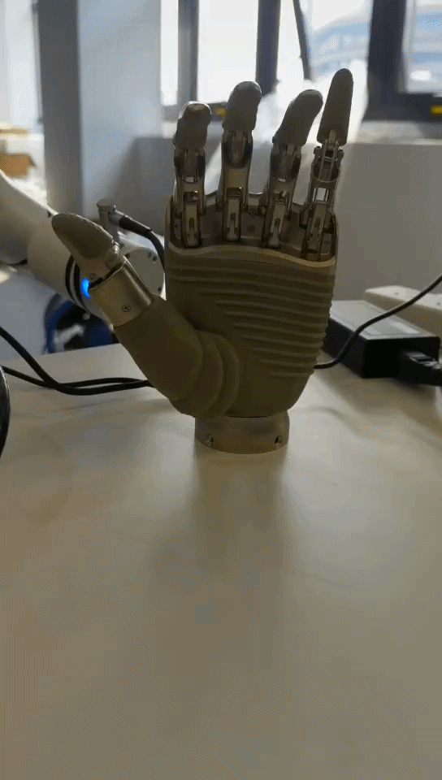

#  末端灵巧手示例

## **1. 项目介绍**

本项目使用睿尔曼提供的机械臂C语言开发包, 演示灵巧手的全方位运动姿态，多关节的协同运动。

## **2. 代码结构**

```
RMDemo_Hand/
├── build/                  # CMake构建生成的输出目录
├── Robotic_Arm/               # 睿尔曼机械臂二次开发包
│   ├── include/
│   │   ├── rm_define.h        # 机械臂二次开发包头文件，包含了定义的数据类型、结构体
│   │   └── rm_interface.h     # 机械臂二次开发包头文件，声明了机械臂所有操作接口
│   └── lib/
│       ├── api_c.dll          # Windows 64bit 的 API 库
│       ├── api_c.lib          # Windows 64bit 的 API 库
│       └── libapi_c.so        # Linux x86 的 API 库
├── src/                     # 源文件存放目录
│   └── main.c               # 主要功能的源文件
├── run.bat                  # Windows快速运行脚本
├── run.sh                   # linux快速运行脚本
├── CMakeLists.txt           # 项目的CMake配置文件
└── readme.md                # 项目说明文档
```

## **3.项目下载**

通过链接下载 `RM_API2` 到本地：[开发包下载](https://github.com/RealManRobot/RM_API2.git)，进入`RM_API2\Demo\RMDemo_C`目录，可找到RMDemo_Hand。

## **4. 环境配置**

在Windows和Linux环境下运行时需要的环境和依赖项：

| 项目      | Linux                                          | Windows                                          |
| :-------- | :--------------------------------------------- | :----------------------------------------------- |
| 系统架构  | x86_64架构                                     | x64                                                |
| 编译器    | GCC 7.5或更高版本                              | MSVC2015或更高版本 64bit                         |
| CMake版本 | 3.10或更高版本                                 | 3.10或更高版本                                   |
| 特定依赖  | RMAPI Linux版本库（位于`Robotic_Arm/lib`目录） | RMAPI Windows版本库（位于`Robotic_Arm/lib`目录） |

### Linux环境配置

**1. 编译器（GCC）**
在大多数Linux发行版中，GCC是默认安装的，但可能版本不是最新的。如果需要安装特定版本的GCC（如7.5或更高版本），可以使用包管理器进行安装。以Ubuntu为例，可以使用以下命令安装或更新GCC：

```bash
# 检查GCC版本
gcc --version

sudo apt update
sudo apt install gcc-7 g++-7
```

注意：如果系统默认安装的GCC版本已满足或高于要求，则无需进行额外安装。

**2. CMake**
CMake在大多数Linux发行版中也可以通过包管理器安装。以Ubuntu为例：

```bash
sudo apt update
sudo apt install cmake

# 检查CMake版本
cmake --version
```

### Windows环境配置

**1. 编译器（MSVC2015或更高版本）**
MSVC（Microsoft Visual C++）编译器通常随Visual Studio一起安装。可以按照以下步骤安装：

1. 访问[Visual Studio官网](https://visualstudio.microsoft.com/)下载并安装Visual Studio。
2. 在安装过程中，选择“使用C++的桌面开发”工作负载，这将包括MSVC编译器。
3. 根据需要选择其他组件，如CMake（如果尚未安装）。
4. 完成安装后，打开Visual Studio命令提示符（可在开始菜单中找到），输入`cl`命令检查MSVC编译器是否安装成功。

**2. CMake**
如果Visual Studio安装过程中未包含CMake，可以单独下载并安装CMake。

1. 访问[CMake官网](https://cmake.org/download/)下载适用于Windows的安装程序。
2. 运行安装程序，按照提示进行安装。
3. 安装完成后，将CMake的bin目录添加到系统的PATH环境变量中（通常在安装过程中会询问是否添加）。
4. 打开命令提示符或PowerShell，输入`cmake --version`检查CMake是否安装成功。

## **5. 使用指南**

### **5.1 快速运行**

灵巧手需支持末端生态协议。程序会将末端供电设为24V、协议波特率设为115200，并执行手指动作。

按照以下步骤快速运行代码：

1. **配置机械臂IP地址**：打开 `src/main.c` 文件，在 `main` 函数中修改 `robot_ip_address` 变量为当前机械臂的IP地址，默认IP地址为 `"192.168.1.18"`。

    ```C
    const char *robot_ip_address = "192.168.1.18";
    int robot_port = 8080;
    rm_robot_handle *robot_handle = rm_create_robot_arm(robot_ip_address, robot_port);
    ```

2. **linux 命令行运行**：
   在终端进入 `RMDemo_Hand` 目录，输入以下命令运行C程序：

   ```bash
   chmod +x run.sh
   ./run.sh
   ```

   运行结果如下：

3. **Windows 运行**： 双击run.bat脚本运行
   运行结果如下：

```bash
Run...
API Version: 1.1.7.t2.
Robot handle created successfully: 1
请按任意键继续. . .
```

运行效果可参照文件中


### **5.2 关键代码说明**

下面是 `main.c` 文件的主要功能：

- **自定义日志输出函数**
  用于接管机械臂 API 的日志输出，格式化打印日志信息，同时做空指针校验避免程序崩溃。

```C
void custom_api_log(const char* message, va_list args) {
    if (!message) {
        fprintf(stderr, "Error: message is a null pointer\n");
        return;
    }
    char buffer[1024];
    vsnprintf(buffer, sizeof(buffer), message, args);
    printf(" %s\n",  buffer);
}
```


- **操作结果检查函数**
统一检查机械臂 API 调用结果，失败时打印错误信息和错误码，并退出程序，停止后续动作。

```C
void check_result(int result, const char *error_message) {
    if (result != 0) {
        printf("%s Error code: %d.\n", error_message, result);
        exit(EXIT_FAILURE);
    }
    return;
}
```

- **灵巧手初始化函数**
将灵巧手各个关节恢复到读取的初始位置

```C
void finger_init(rm_robot_handle* robot_handle, const int pos[6]) {
    WAIT(2);
    check_result(rm_set_hand_follow_pos(robot_handle, pos, true), "rm_set_hand_follow_pos unseccessfully!\n");
    WAIT(2);
    return;
}
```
**主函数（main）核心逻辑**

- **API初始化和连接机械臂**
  初始化 API 并连接机械臂。

```C
    rm_set_log_call_back(custom_api_log, 3);
    check_result(rm_init(RM_TRIPLE_MODE_E), "Initialization failed");
    printf("API Version: %s.\n", rm_api_version());

    const char *robot_ip_address = "192.168.1.18";
    int robot_port = 8080;
    rm_robot_handle *robot_handle = rm_create_robot_arm(robot_ip_address, robot_port);
    if (robot_handle == NULL || robot_handle->id <= 0) {
        printf("Failed to create robot handle.\n");
        rm_destroy();
        return EXIT_FAILURE;
    }
    printf("Robot handle created successfully: %d\n", robot_handle->id);
```

- **配置工具端和灵巧手参数**

  ```C
    int voltage = -1, mode = -1;
    check_result(rm_get_tool_voltage(robot_handle, &voltage), "Failed to get tool voltage!\n");
    if (voltage != 3) {check_result(rm_set_tool_voltage(robot_handle, 3), "Failed to set tool voltage!\n");}
    check_result(rm_get_rm_plus_mode(robot_handle, &mode), "Failed to get plus mode!\n");
    if (mode != 115200) {check_result(rm_set_rm_plus_mode(robot_handle, 115200), "Failed to set plus mode!\n");}
    WAIT(15);

    check_result(rm_set_hand_speed(robot_handle, 500), "Failed to set hand speed!\n");
    check_result(rm_set_hand_force(robot_handle, 500), "Failed to set hand force!\n");
```

- **读取机械臂灵巧手寄存器参数**

  ```C
    int arr[6] = { 0,0,0,0,0,0 }, Init[6] = { 0 }, High_pos[6] = { 0 }, Low_pos[6] = { 0 }, High_angle[6] = { 0 }, Low_angle[6] = { 0 };
    check_result(rm_get_rm_plus_reg(robot_handle, 1100, 6, arr), "Failed to get puls base date!\n");
    for (int i = 0; i < 6; i++) { High_pos[i] = arr[i]; printf("High_pos[%d] is %d\n", i, High_pos[i]);}

    check_result(rm_get_rm_plus_reg(robot_handle, 1120, 6, arr), "Failed to get puls base date!\n");
    for (int i = 0; i < 6; i++) { Low_pos[i] = arr[i]; Init[i] = arr[i]; printf("Low_pos[%d] is %d\n", i, Low_pos[i]);}

    check_result(rm_get_rm_plus_reg(robot_handle, 1140, 6, arr), "Failed to get puls base date!\n");
    for (int i = 0; i < 6; i++) { High_angle[i] = arr[i]; printf("High_angle[%d] is %d\n", i, High_angle[i]);}

    check_result(rm_get_rm_plus_reg(robot_handle, 1160, 6, arr), "Failed to get puls base date!\n");
    for (int i = 0; i < 6; i++) { Low_angle[i] = arr[i]; printf("Low_angle[%d] is %d\n", i, Low_angle[i]);}
    for (int i = 0; i < 6; i++) {
        if (Low_pos[i] < 0 || High_pos[i] > 65535 || Low_pos[i] > High_pos[i] ||
            Low_angle[i] < -32768 || Low_angle[i] > 32767 ||
            High_angle[i] < -32768 || High_angle[i] > 32767) {
            check_result(1, "Invalid hand calibration range");
        }
    }
```

- **控制灵巧手运动**

  ```C
    finger_init(robot_handle, Init);
    WAIT(2);
    for (int i = 1; i < 6; i++) {
        WAIT(1);
        while (Low_pos[i] < High_pos[i]) {
            Low_pos[i] += 1000;
            if (Low_pos[i] > High_pos[i]) {Low_pos[i] = High_pos[i];}
            Low_pos[i - 1] = Init[i - 1];
            check_result(rm_set_hand_follow_pos(robot_handle, Low_pos, true), "setting hand follow pos unseccessfully!\n");
            msleep(20);
        }
    }

    //yeah pose of the hand
    finger_init(robot_handle, Init);
    int yeah_angle[6] = { Low_angle[0], High_angle[1], High_angle[2], Low_angle[3], Low_angle[4], Low_angle [5]};
    check_result(rm_set_hand_follow_angle(robot_handle, yeah_angle, true), "set hand follow angle yeah unseccessfully!\n");

    //ok pose of the hand
    finger_init(robot_handle, Init);
    int ok_angle[6] = { High_angle[0], Low_angle[1], High_angle[2], High_angle[3], High_angle[4], High_angle[5]};
    check_result(rm_set_hand_follow_angle(robot_handle, ok_angle, true), "set hand follow angle ok unseccessfully!\n");
    WAIT(2);
    ok_angle[0] = Low_angle[0];
    check_result(rm_set_hand_follow_angle(robot_handle, ok_angle, true), "set hand follow angle ok  2 unseccessfully!\n");
    WAIT(1);
    ok_angle[0] = High_angle[0];
    check_result(rm_set_hand_follow_angle(robot_handle, ok_angle, true), "set hand follow angle ok  3 unseccessfully!\n");

    //six pose of the hand
    finger_init(robot_handle, Init);
    int six_angle[6] = { High_angle[0], Low_angle[1], Low_angle[2], Low_angle[3], High_angle[4], High_angle [5]};
    check_result(rm_set_hand_follow_angle(robot_handle, six_angle, true), "set hand follow angle six unseccessfully!\n");
    WAIT(1);
    six_angle[5] = Low_angle[5];
    check_result(rm_set_hand_follow_angle(robot_handle, six_angle, true), "set hand follow angle six 2 unseccessfully!\n");
    WAIT(0.5);
```

- **断开机械臂连接**

  ```C
    check_result(rm_delete_robot_arm(robot_handle), "Failed to disconnect the robot arm");
    check_result(rm_destroy(), "Failed to destroy API");
    return 0;
```
## **6. 许可证信息**

- 本项目遵循MIT许可证。
